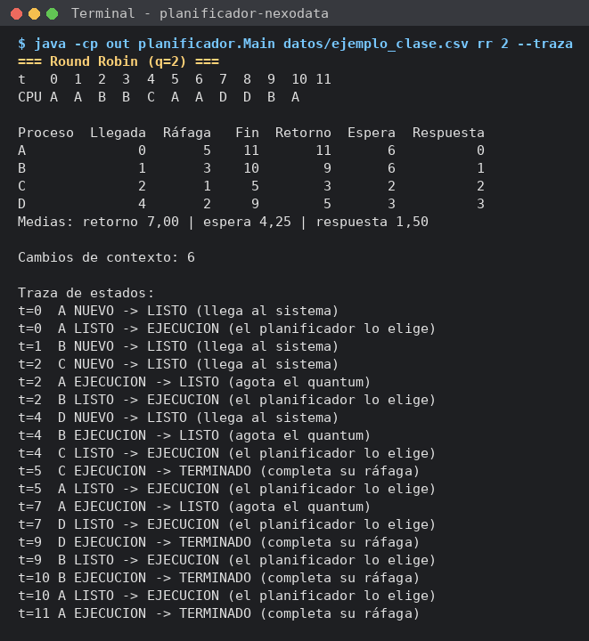
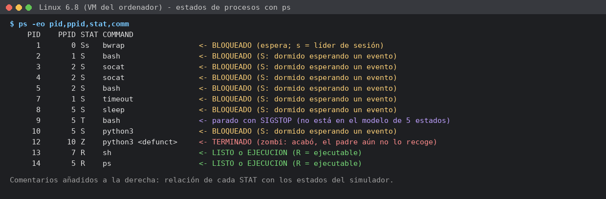

# Simulador de planificación · NexoData

> PSP · Tema 2 · Procesos · 2.º A DAM · **Sergio Mitchell Bocero**

## 1. Qué hace

Programa de consola en Java que simula cómo un planificador de corto plazo reparte una CPU entre varios procesos. Lee de un fichero CSV los procesos (nombre, llegada y ráfaga), los ejecuta con **FCFS**, **SJF sin desalojo** o **Round Robin** con el quantum indicado (o los tres seguidos con `todos`) y muestra el diagrama de Gantt, la tabla de métricas (fin, retorno, espera y respuesta) con sus medias, los cambios de contexto y, con `--traza`, cada transición de estado. Con él se comparan las políticas para los trabajos nocturnos de NexoData.

## 2. Cómo compilar y ejecutar

Requisitos: JDK 17 o superior (probado con JDK 21).

```
java planificador.Main <fichero.csv> <fcfs|sjf|rr|todos> [quantum] [--traza]
```

Si no se indica quantum, se usa 2.

**Desde la terminal**, en la carpeta del proyecto:

```bash
javac -encoding UTF-8 -d out src/planificador/*.java
java -cp out planificador.Main datos/ejemplo_clase.csv rr 2 --traza
java -cp out planificador.Main datos/nocturno.csv todos 4
java -cp out planificador.Main datos/verificacion.csv fcfs
java -cp out planificador.Main datos/hueco.csv sjf
```

**Desde IntelliJ IDEA:**

1. *File → Open* y elegir la carpeta `planificador-nexodata`.
2. *File → Project Structure → Project*: SDK **17 o superior** (yo uso la 21) y *Language level* por defecto del SDK. Si `src` no aparece en azul: clic derecho → *Mark Directory as → Sources Root*.
3. Abrir `src/planificador/Main.java` y ejecutarlo una vez con la flecha verde (saldrá el mensaje de uso porque faltan argumentos).
4. *Run → Edit Configurations…* → configuración `Main`:
   - *Program arguments*: `datos/ejemplo_clase.csv rr 2 --traza` (o cualquier otra combinación).
   - *Working directory*: la carpeta del proyecto (`$PROJECT_DIR$`), porque las rutas `datos/…` son relativas a ella.
5. Ejecutar de nuevo con la flecha verde.



## 3. Diseño

Todo está en el paquete `planificador`:

| Clase | Responsabilidad |
|---|---|
| `Main` | (de la plantilla) Lee y valida los argumentos; carga los procesos, crea los planificadores pedidos y pasa cada resultado al informe. |
| `EstadoProceso` | `enum` con los cinco estados del modelo: `NUEVO`, `LISTO`, `EJECUCION`, `BLOQUEADO`, `TERMINADO`. |
| `Proceso` | Datos del fichero (nombre, llegada, ráfaga y posición en el fichero, inmutables) y estado de simulación (tiempo restante, estado, primer uso de CPU y fin). Calcula retorno, espera y respuesta. `copia()` devuelve un proceso nuevo con los mismos datos y el estado reiniciado. |
| `LectorProcesos` | Lee el CSV: ignora líneas vacías y `#comentarios` y lanza `ErrorFormatoException` con el número de línea si hay campos de más o de menos, números no enteros, llegada negativa o ráfaga ≤ 0. |
| `ErrorFormatoException` | Excepción propia para los errores del fichero; `Main` muestra su mensaje y termina. |
| `Planificador` | **Clase abstracta con el bucle de simulación, escrito una sola vez** (`simular`, `final`). Define dos puntos de variación: `elegir(listos)` (a quién da la CPU) y `agotaTurno(usado)` (si se la quita antes de terminar; por defecto, nunca). |
| `PlanificadorFCFS` | `elegir` → cabeza de la cola. Sin desalojo. |
| `PlanificadorSJF` | `elegir` → mínimo por ráfaga, luego llegada, luego orden en el fichero (regla 5). Sin desalojo. |
| `PlanificadorRR` | `elegir` → cabeza de la cola; `agotaTurno` → `usado >= quantum`. El quantum llega por el constructor. |
| `ResultadoSimulacion` | Lo que devuelve una simulación: procesos terminados, Gantt (`null` = CPU ociosa), cambios de contexto y traza; calcula las medias. |
| `Transicion` | `record` con una línea de la traza: instante, proceso, estado origen, estado destino y motivo. |
| `Informe` | Imprime Gantt, tabla, medias, cambios de contexto y traza. |

**Por qué así:**

- **Método plantilla con una clase abstracta.** Los tres algoritmos comparten el avance del tiempo, las llegadas, la ejecución, las métricas y la traza; solo cambian *a quién eligen* y *cuándo quitan la CPU*. Por eso el bucle está una sola vez en `Planificador.simular()` y cada subclase solo implementa esas dos decisiones (FCFS y SJF, una línea cada uno). Elegí clase abstracta en lugar de interfaz porque el bucle es código común que no debe sobrescribirse (por eso es `final`) y porque `agotaTurno` tiene un comportamiento por defecto razonable (sin desalojo).
- **Orden fijo de cada instante *t*:** 1) llegadas en *t* en el orden del fichero; 2) el proceso en CPU termina o agota su quantum; 3) si la CPU está libre, el algoritmo elige; 4) se ejecuta una unidad y se avanza. Con este orden salen solas la regla 3 (el que llega en *t* ya está en la cola cuando se encola el desalojado) y la regla 4 (si la cola está vacía tras agotar el quantum, el proceso sigue con un quantum nuevo, sin pasar por LISTO).
- **Los datos originales no se tocan.** `simular()` trabaja sobre `copia()` de cada proceso, así que con `todos` los tres algoritmos parten de los mismos procesos en estado NUEVO (pista de la tarea 1).
- **Cola de listos como `List` en orden de entrada.** FCFS y RR toman la cabeza y los desalojados se añaden al final (FIFO); SJF necesita buscar el mínimo entre todos, y con una lista basta un `stream().min()`.
- **Simulación y presentación separadas.** El planificador no imprime nada: devuelve un `ResultadoSimulacion` y `Informe` decide el formato. Así se puede cambiar la salida sin tocar los algoritmos.
- **Cambios de contexto:** se cuenta cuando el proceso elegido es distinto del último que usó la CPU; la primera carga no cuenta y, si la CPU estuvo ociosa y entra otro proceso, sí cuenta.

## 4. Verificación (tarea 4)

### 4.1 verificacion.csv resuelto a mano

Datos: `P1;0;6 · P2;1;4 · P3;2;2 · P4;4;5 · P5;6;1`. Lo resolví a mano antes de ejecutar el programa siguiendo las reglas del enunciado (casilla *t* = intervalo [t, t+1); fin = última casilla + 1).

#### FCFS

Decisiones del planificador (solo cuando la CPU queda libre, porque no hay desalojo):

| t | Qué pasa | Cola de listos al decidir | Elige |
|---|---|---|---|
| 0 | llega P1 | [P1] | P1 |
| 6 | P1 termina | [P2, P3, P4, P5] | P2 |
| 10 | P2 termina | [P3, P4, P5] | P3 |
| 12 | P3 termina | [P4, P5] | P4 |
| 17 | P4 termina | [P5] | P5 |

```
t    0  1  2  3  4  5  6  7  8  9  10 11 12 13 14 15 16 17 18
CPU  P1 P1 P1 P1 P1 P1 P2 P2 P2 P2 P3 P3 P4 P4 P4 P4 P4 P5
```

| Proceso | Llegada | Ráfaga | Fin | Retorno | Espera | Respuesta |
|---|---|---|---|---|---|---|
| P1 | 0 | 6 | 6 | 6 | 0 | 0 |
| P2 | 1 | 4 | 10 | 9 | 5 | 5 |
| P3 | 2 | 2 | 12 | 10 | 8 | 8 |
| P4 | 4 | 5 | 17 | 13 | 8 | 8 |
| P5 | 6 | 1 | 18 | 12 | 11 | 11 |
| **Media** | | | | **10,00** (50/5) | **6,40** (32/5) | **6,40** (32/5) |

Cambios de contexto: P1→P2, P2→P3, P3→P4, P4→P5 = **4**.

#### Round Robin, quantum 2

Cola de listos en cada instante en que el planificador decide (la cola se escribe de cabeza a final; «antes» = después de aplicar llegadas y fin/desalojo del instante; «después» = tras sacar al elegido):

| t | Qué pasa en ese instante (en este orden) | Cola antes de decidir | Elige | Cola después |
|---|---|---|---|---|
| 0 | llega P1 | [P1] | P1 | [ ] |
| 1 | llega P2 (P1 lleva 1 de 2: no hay decisión) | — | — | [P2] |
| 2 | llega P3; P1 agota el quantum y va **detrás de P3** (regla 3) | [P2, P3, P1] | P2 | [P3, P1] |
| 4 | llega P4; P2 agota el quantum | [P3, P1, P4, P2] | P3 | [P1, P4, P2] |
| 6 | llega P5; P3 termina (fin 6) | [P1, P4, P2, P5] | P1 | [P4, P2, P5] |
| 8 | P1 agota el quantum | [P4, P2, P5, P1] | P4 | [P2, P5, P1] |
| 10 | P4 agota el quantum | [P2, P5, P1, P4] | P2 | [P5, P1, P4] |
| 12 | P2 termina (fin 12) | [P5, P1, P4] | P5 | [P1, P4] |
| 13 | P5 termina (fin 13) | [P1, P4] | P1 | [P4] |
| 15 | P1 termina (fin 15) | [P4] | P4 | [ ] |
| 17 | P4 agota el quantum pero la cola está vacía: **sigue** con quantum nuevo (regla 4, sin cambio de contexto) | [ ] | P4 (sigue) | [ ] |
| 18 | P4 termina (fin 18) | — | — | — |

```
t    0  1  2  3  4  5  6  7  8  9  10 11 12 13 14 15 16 17 18
CPU  P1 P1 P2 P2 P3 P3 P1 P1 P4 P4 P2 P2 P5 P1 P1 P4 P4 P4
```

| Proceso | Llegada | Ráfaga | Fin | Retorno | Espera | Respuesta |
|---|---|---|---|---|---|---|
| P1 | 0 | 6 | 15 | 15 | 9 | 0 |
| P2 | 1 | 4 | 12 | 11 | 7 | 1 (2−1) |
| P3 | 2 | 2 | 6 | 4 | 2 | 2 (4−2) |
| P4 | 4 | 5 | 18 | 14 | 9 | 4 (8−4) |
| P5 | 6 | 1 | 13 | 7 | 6 | 6 (12−6) |
| **Media** | | | | **10,20** (51/5) | **6,60** (33/5) | **2,60** (13/5) |

Cambios de contexto: P1→P2 (2), P2→P3 (4), P3→P1 (6), P1→P4 (8), P4→P2 (10), P2→P5 (12), P5→P1 (13), P1→P4 (15) = **8**. En t=17 no hay cambio porque P4 sigue en la CPU.

### 4.2 Comparación con el programa

```
java -cp out planificador.Main datos/verificacion.csv fcfs
java -cp out planificador.Main datos/verificacion.csv rr 2 --traza
```

| | A mano | Programa | ¿Coincide? |
|---|---|---|---|
| FCFS · Gantt | P1×6 P2×4 P3×2 P4×5 P5 | igual | Sí |
| FCFS · medias (ret / esp / resp) | 10,00 / 6,40 / 6,40 | 10,00 / 6,40 / 6,40 | Sí |
| FCFS · cambios | 4 | 4 | Sí |
| RR q=2 · Gantt | P1 P1 P2 P2 P3 P3 P1 P1 P4 P4 P2 P2 P5 P1 P1 P4 P4 P4 | igual | Sí |
| RR q=2 · medias | 10,20 / 6,60 / 2,60 | 10,20 / 6,60 / 2,60 | Sí |
| RR q=2 · cambios | 8 | 8 | Sí |

Los dos instantes delicados salen bien en la traza del programa:

```
t=2  P3 NUEVO -> LISTO (llega al sistema)
t=2  P1 EJECUCION -> LISTO (agota el quantum)      <- regla 3: P3 entra antes que P1
t=2  P2 LISTO -> EJECUCION (el planificador lo elige)
...
t=17 P4 sigue en EJECUCION (agota el quantum sin nadie en la cola: turno nuevo)   <- regla 4
t=18 P4 EJECUCION -> TERMINADO (completa su ráfaga)
```

**Resultado:** la resolución a mano y el programa coincidieron en todo, así que no hubo que corregir nada en esta tarea. La razón es que el orden de los pasos de cada instante (1. llegadas, 2. fin/desalojo, 3. elección, 4. ejecución) se fijó en el bucle común antes de escribir Round Robin (commit «Tarea 2: Round Robin con quantum configurable»); si los pasos 1 y 2 se invirtieran, en t=2 P1 se colaría delante de P3 y el Gantt cambiaría desde la casilla 4 (P1 en lugar de P3). También se comprobó que `ejemplo_clase.csv rr 2 --traza` reproduce exactamente la salida de referencia del enunciado (A A B B C A A D D B A, medias 7,00 / 4,25 / 1,50, 6 cambios).

### 4.3 hueco.csv

`java -cp out planificador.Main datos/hueco.csv todos 2`

| Algoritmo | Gantt (t = 0 … 10) | Retorno / espera / respuesta medios | Cambios |
|---|---|---|---|
| FCFS | `X X - - - Y Y Y Z W W` | 3,50 / 1,50 / 1,50 | 3 |
| SJF | `X X - - - Z W W Y Y Y` | 2,75 / 0,75 / 0,75 | 3 |
| RR q=2 | `X X - - - Y Y Z W W Y` | 3,75 / 1,75 / 1,00 | 4 |

X termina en t=2 y el siguiente proceso (Y y Z) no llega hasta t=5, así que entre los instantes 2 y 5 no hay nadie en LISTO y la CPU queda **ociosa**: el diagrama lo muestra con un guion en las casillas 2, 3 y 4. En t=5 llegan Y y Z a la vez: FCFS y RR atienden primero a Y porque aparece antes en el fichero (regla 2), mientras que SJF elige a Z por tener la ráfaga más corta; y en t=2 SJF no «adelanta» a ningún proceso que aún no ha llegado. El paso de X a Y (o Z) tras la CPU ociosa sí cuenta como cambio de contexto.

## 5. Análisis y recomendación a NexoData (tarea 5)

Comandos: `java -cp out planificador.Main datos/nocturno.csv todos 4` (FCFS, SJF y RR q=4) y `... nocturno.csv rr 1` / `rr 2`. Unidades: minutos.

| nocturno.csv | Retorno medio | Espera media | Respuesta media | Cambios de contexto |
|---|---|---|---|---|
| FCFS | 14,00 | 10,00 | 10,00 | 5 |
| SJF | **11,67** | **7,67** | 7,67 | 5 |
| RR q=1 | 12,33 | 8,33 | **1,50** | 22 |
| RR q=2 | 12,17 | 8,17 | 2,83 | 11 |
| RR q=4 | 14,50 | 10,50 | 6,17 | 8 |

En las cinco ejecuciones todos los trabajos terminan en el minuto 24 (9+2+6+1+4+2 = 24 minutos de CPU y la CPU nunca está ociosa): **la máquina tarda lo mismo con cualquier algoritmo; lo único que cambia es quién espera y cuánto**.

1. **Menor espera media: SJF, con 7,67 min** (frente a 10,00 de FCFS, un 23 % menos). FACTURA ocupa la CPU de 0 a 9 igual que en FCFS porque llega sola y no hay desalojo, pero en t=9 SJF reordena la cola por ráfaga: pasan primero LOGS (1), INFORME (2) y AVISOS (2), después RUTAS (4) y al final BACKUP (6). Al atender antes a los cortos, su espera se suma pocas veces: LOGS pasa de 14 a 6 minutos y AVISOS de 16 a 6, mientras que solo BACKUP empeora (9 → 16). Con cada trabajo corto que se adelanta, esperan menos procesos detrás de él.

2. **En FCFS, LOGS espera 14 minutos para trabajar 1**: llega en t=3 y no entra hasta t=17 (retorno 15, es decir, 15 veces su ráfaga). Es el **efecto convoy**: los trabajos cortos quedan atrapados detrás de uno largo. Lo provoca sobre todo **FACTURA** (9 minutos, llega el primero y no se le puede desalojar), y lo agrava BACKUP (6 minutos), que también le llegó antes.

3. **En SJF el peor parado es BACKUP**: espera 16 minutos y termina el último (fin 24, retorno 22), porque es la ráfaga más larga de las que quedan en t=9 y todos los demás se le adelantan. Si cada pocos minutos llegaran trabajos cortos nuevos, siempre habría alguno más corto que él y BACKUP podría no ejecutarse nunca: es la **inanición** (*starvation*). Se evita con **envejecimiento** (*aging*): la prioridad de un proceso aumenta con el tiempo que lleva esperando, hasta que acaba pasando por delante de los cortos.

4. **Al bajar el quantum de 4 a 1, la respuesta media mejora de 6,17 a 2,83 (q=2) y a 1,50 (q=1), pero los cambios de contexto pasan de 8 a 11 y a 22** (casi uno por minuto: 22 cambios en 24 minutos). Con q=1 todos los trabajos tocan la CPU en, como mucho, 3 minutos desde que llegan. El simulador supone que cambiar de contexto no cuesta nada, pero en un SO real cada cambio supone guardar y restaurar registros, cambiar el mapa de memoria y perder caché y TLB, así que con un quantum muy pequeño una parte importante de la CPU se gastaría en cambiar de proceso en vez de en trabajar. Además, en un SO de verdad el quantum se mide en milisegundos (del orden de 10–100 ms), no en minutos: un «quantum de 1 minuto» real sería enorme para un sistema interactivo, y lo que importa es la proporción entre quantum, coste del cambio y longitud de las ráfagas. Aquí q=1 significa trocear ráfagas de 1–9 unidades en trozos mínimos, lo que solo tiene sentido si el cambio es muy barato comparado con el quantum.

5. **RR q=4 tiene más espera media que FCFS (10,50 frente a 10,00)**, aunque reparte la CPU «más justamente». Puede sorprender, pero tiene sentido: Round Robin no hace que haya menos trabajo, solo lo intercala. Mejora a los cortos (INFORME 8 → 3, LOGS 14 → 7), pero a los largos les hace esperar mucho más: FACTURA se interrumpe en t=4 y ya no termina hasta t=24 (espera 0 → 15) y BACKUP pasa de 9 a 15. Además, el orden de la cola sigue siendo el de llegada, así que LOGS (llega en 3) tiene que esperar el quantum completo de BACKUP (llegó en 2) de t=6 a t=10. La ganancia de RR está en la **respuesta** (6,17 frente a 10,00), no en la espera: para reducir la espera media hay que ejecutar antes a los cortos, que es lo que hace SJF.

6. **Mi simulador nunca pone un proceso en BLOQUEADO** porque cada proceso del fichero es una única ráfaga de CPU: no hace ninguna operación de E/S ni espera a ningún evento. Un proceso solo pasa a BLOQUEADO cuando, estando en EJECUCION, pide algo que no está disponible todavía (leer el disco, la red, un teclado, un semáforo…); sin ráfagas de E/S en los datos, esa transición no se produce nunca. En la realidad, BACKUP, por ejemplo, pasaría gran parte del tiempo bloqueado escribiendo en disco, y en ese rato la CPU atendería a otro trabajo.

   Captura de `ps` en el Linux de la máquina virtual del ordenador, con un proceso en bucle de CPU, varios `sleep`, uno parado con `kill -STOP` y un zombi creado a propósito (comentarios añadidos a la derecha):

   

   | `STAT` en Linux | Significado | Estado del simulador |
   |---|---|---|
   | `R` (*running or runnable*) | en CPU o en la cola de ejecutables | **EJECUCION** o **LISTO**: Linux no los distingue en esta columna (`ps` sale como R porque se está ejecutando; `sh` está en bucle de CPU) |
   | `S` (*interruptible sleep*) | dormido esperando un evento (un temporizador en `sleep`, datos en `socat`) | **BLOQUEADO** |
   | `D` (*uninterruptible sleep*) | esperando E/S de disco, no se puede interrumpir | **BLOQUEADO** (no aparece en la captura porque no había E/S en curso) |
   | `Z` (*zombie*) | ha terminado, pero su padre aún no ha recogido su código de salida con `wait()` | **TERMINADO** |
   | `T` (*stopped*) | detenido por una señal (`SIGSTOP`, Ctrl+Z) | no existe en el modelo de cinco estados (sería un estado «suspendido») |

   **NUEVO** no se ve en `ps`: es un instante muy breve mientras el núcleo crea el proceso (`fork`) antes de que pase a ser ejecutable. Los modificadores que acompañan a la letra (`s` líder de sesión, `+` en primer plano, `<`/`N` prioridad alta/baja, `l` multihilo) no son estados. En Windows, el Administrador de tareas (pestaña *Detalles*, columna *Estado*) solo muestra «En ejecución», «Suspendido» o «No responde»: «En ejecución» agrupa LISTO, EJECUCION y BLOQUEADO, porque Windows planifica hilos, no procesos, y el estado de cada hilo (*Ready*, *Running*, *Waiting*…) solo se ve con herramientas como el Monitor de recursos o Process Explorer.

### Recomendación

Para los trabajos nocturnos recomiendo **SJF sin desalojo**: con sus datos da la menor espera media (7,67 min frente a 10,00 de FCFS) y el menor retorno medio (11,67 frente a 14,00), sin más cambios de contexto que FCFS (5).
Son trabajos por lotes que se repiten cada noche, así que su duración se puede estimar bien con el historial, que es lo que SJF necesita.
La inanición de BACKUP no es un problema en un lote cerrado de seis trabajos (siempre acaba en el minuto 24); si se añadieran trabajos durante la noche, habría que aplicar envejecimiento.
**No hace falta un servidor nuevo**: los 24 minutos de CPU son los mismos con cualquier algoritmo; LOGS e INFORME tardan porque quedan detrás de FACTURA y BACKUP.
Por eso, además, conviene lanzar FACTURA unos minutos después de los trabajos cortos, ya que sin desalojo nadie puede adelantarle una vez que entra en t=0.
En un **servidor con usuarios conectados** sí cambiaría a **Round Robin** con quantum pequeño: ahí importa la respuesta (1,50–2,83 min con q=1–2 frente a 7,67 de SJF) y que nadie quede atascado detrás de un trabajo largo, aceptando más cambios de contexto (11–22) con un quantum real de milisegundos.
